# Tillerz Todo Mgr

[](https://github.com/Tillerz/todomgr/actions/workflows/test.yml)

A small, portable todo, idea, and project manager. One program, no installation: the UI, the API,
 the command line and the (optional) MCP server for AI assistants are all in one executable.
 The UI runs in your web browser: start the program and it opens `http://localhost:7437/` (configurable).
 The page comes from your own computer or local network, so you need no internet connection and no account.
 Everything you enter is stored in the `data/` folder next to the program, so you can copy
 the folder to a USB stick or a synced drive and take it with you.

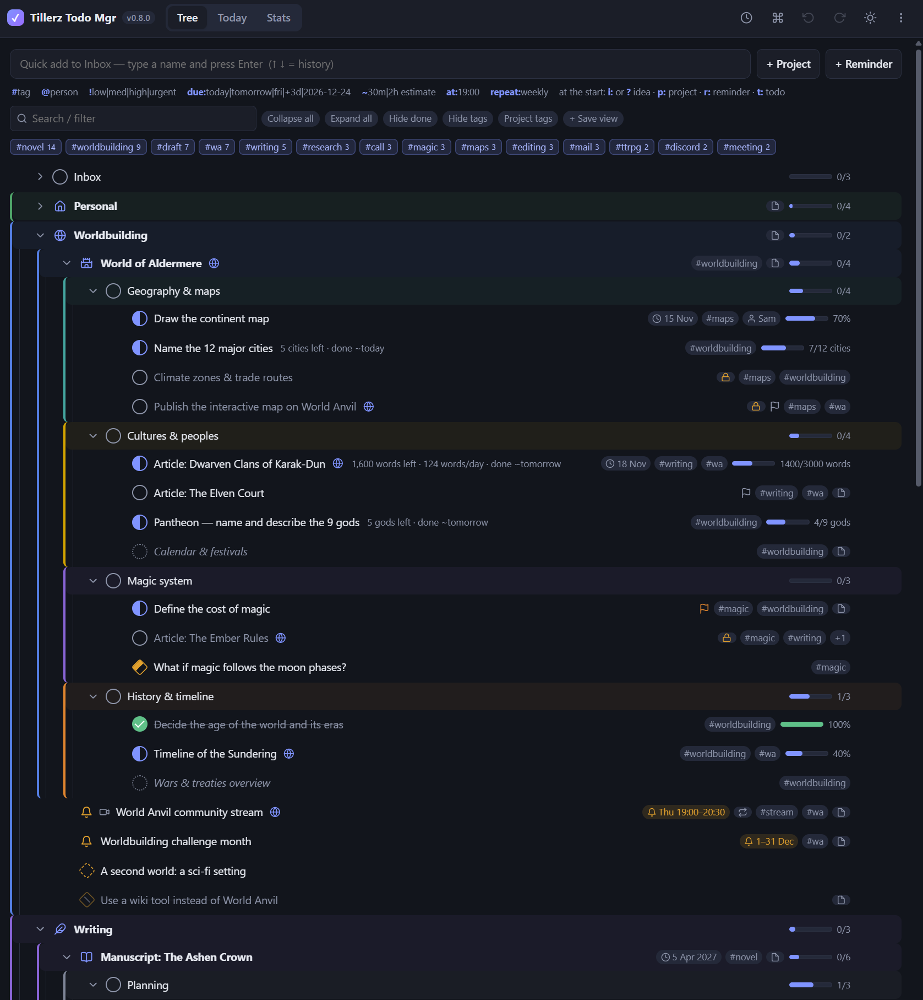

More in [Screenshots](#screenshots).

## At a glance

### 100% local

- Everything runs on your own computer: no account, no cloud, no tracking, and no internet connection needed.
- The program never goes online by itself. The only exception is a Discord announcement, and only when you set up a webhook for a project and send one.
- The optional AI also runs on your computer. Your entries and notes never leave it.

### Capture in seconds

- Quick Add: type `Call Anna @anna !high due:fri at:14:00` and it creates a todo with the person, priority, date, and time already set. Normal words work too: `Dentist tomorrow at 3pm`.
- Tags and people autocomplete, so `#Work` and `#work` never split into two.
- Todos, ideas, projects and reminders live together in one tree.

### Plan your day

- **Today** shows what is overdue, due, running and coming up, and **Next 7 days** shows the week ahead, day by day.
- A day plan bar warns you when your estimates and meetings do not fit into the work day.
- A countdown timer or stopwatch logs the time to the task you worked on.
- Word or page goals show how much per day you need, and when you will be done at your speed so far. *Today* shows each goal's amount for today, and `+500` logs new words in two clicks.

### Made for writers

- **Word goals that keep up with you:** give a manuscript, a chapter or a short story a word goal and a deadline. The app works out how many words you need today, and when you miss a day, it spreads the rest over the days left by itself.
- **Writing goals at the top of Today:** today's amount, a bar for what you wrote today, the words left, and when you will be done at your speed so far.
- **Log words in two clicks:** click *+ Log* or "words left", type `+500` (or the new total), press Enter. Scripts and other writing tools can add words through the API.
- **Write with the timer:** the clock next to a goal starts a countdown or stopwatch for it. When it stops, the time is logged and the app asks how many words you wrote.
- **A daily writing habit:** "Write 500 words", repeating every day, shows on Today until you have written today's words, then waits for tomorrow.
- **A picture that grows with your manuscript:** a stack of pages that becomes a bound book with your title, or a walk across a map to a castle, from 0 to 100 %.
- **Chapters in order:** a chapter that depends on the one before it waits until that one is done, and only then shows up as a goal.
- **A cheer when you reach a goal**.

See [Progress](#progress) for the details.

### Never miss a date

- Reminders pop up even when no browser window is open, with an early warning if you want one.
- The computer was off? The reminder waits for you as "missed".
- Repeats of every kind: every 2 weeks, the 1st and 3rd Friday, the last Sunday of every 3rd month, or 3 days after you last did it.
- Todos that follow an event: the session diary waits for game night, is due 8 days after it, and comes back for the next one.
- Events with a start and an end, from a 2-hour stream to a 3-day convention.

### Keep big projects under control

- Nest entries as deep as you like, drag and drop to reorder them (or use the keyboard), or sort them by name, priority or date.
- Progress adds up from the sub-entries, and dependencies show what is blocked.
- Give projects an icon and a colour. Select many entries and change them together.
- Announce finished tasks in your Discord channel via Webhook.

### Notes that work like a wiki

- Open/close a large editor window for the Notes quickly via **Alt-Enter**.
- Notes take Markdown or BBCode and show the output accordingly.
- Link other entries with `[[` (with suggestion/autocomplete), and see which entries link back.
- Drop a mail or a file onto an entry: the app keeps a copy, and a click shows it. Mails show sender, subject, date and text.

### Your data stays yours

- One program for Windows, macOS and Linux. No install, no account, no cloud.
- Install it as an app window (on Windows)
- Copy the folder to an USB stick and take everything with you.
- Every change is saved at once, and automatic backups restore with one click.
- Undo and Redo restore accidental changes immediately.
- Open it from your phone or tablet at home (LAN access, off by default). Quickly log in by scanning a QR code (the code works once and only for 5 minutes).

### Works with your other tools

- Import from Outlook, Google, Apple or Thunderbird calendar files, and from CSV or Excel: drop the files onto Quick add and pick the entries you want. Import an updated file again and you only get the new entries.
- Subscribe to your TodoMgr dates in Apple Calendar, Outlook or Thunderbird: they update by themselves, without copies.
- Export to CSV, a calendar file, Markdown, or a printed list.
- A command line (`todo add "…"`), an API, and an MCP server, so AI assistants such as Claude can read and update your list.

### Nice to use

- Six themes, each in light and dark mode, with your choice of font, text size, and line height. The layout adapts to narrow windows.
- [Keyboard shortcuts](#keyboard-shortcuts) (hotkey `?`), a command palette (`Ctrl+K`), and undo for every change (`Ctrl-Z`).
- Statistics with a GitHub-style heatmap of what you got done.

Every feature in detail: [Features](#features).

## Contents

- [At a glance](#at-a-glance)
- [Run it](#run-it)
- [Features](#features)
- [Where the data is, and how it is kept safe](#where-the-data-is-and-how-it-is-kept-safe)
- [Command line](#command-line)
- [Build](#build)
- [Screenshots](#screenshots)
- [MCP server for AI assistants](#mcp-server-for-ai-assistants)
- [HTTP API](#http-api)
- [Licence](#licence)
- [Third-party licences](#third-party-licences)

## Run it

```
./todo                 # start and open the browser   (todo.exe on Windows)
./todo serve           # start only; open http://localhost:7437/ in your browser manually
./todo serve --data /path/to/data --port 7437
```

Stop it with `Ctrl+C`. Every change is saved immediately; nothing is lost if the program is killed. The program listens on `127.0.0.1` only, so it can only be reached from the same computer, unless you switch on [LAN access](#lan-access-phone-tablet-other-computers).

### Install as an app

In Chrome or Edge, open `http://localhost:7437/` and click the **Install** icon in the address bar (or look for "Install" in the browser menu). The app then opens in its own window, without the address bar, and gets a start menu / dock icon. The program must still be running; if it is not, the window says so. Nothing is stored in the browser: all data stays in the `data/` folder.

### LAN access (phone, tablet, other computers)

**Off by default.** Switch it on in Settings → LAN access and restart the program. It then also listens on
your network (Windows asks once if the firewall may allow it) and prints the addresses to use, for example
`http://192.168.1.20:7437/`. Settings shows them too, with the token.

- This computer works as before. Every other device first sees a login page and types the token once; after that it stays logged in.
- **QR code:** or click *Show QR code* in Settings → LAN access and scan it with the camera of the phone or tablet: the link opens the app and logs in. The QR code holds a one-time code, not the token: it works once and only for 5 minutes, so a photo or screenshot of it is useless afterwards.
- After 5 wrong tokens, a device has to wait a minute before it can try again.
- Only IP addresses and this computer's own name (`mypc`, `mypc.local`) are accepted as the address, so web pages cannot reach the program through their own domain names.
- AI tools (MCP) can still only connect from this computer.
- A phone cannot install it as an app over a LAN address: browsers only allow that on `localhost` or `https`. It works as a normal page (and "Add to Home screen" adds a bookmark icon).
- Without a screen (a server): set `"lanEnabled": true` in `data/config.json`; the token is in the same file.

> [!WARNING]
> **Use it only on networks you trust**, such as your home Wi-Fi: the connection is not encrypted (plain `http`), so someone in the same network could read the token. For access from outside your home, a private network such as Tailscale encrypts the connection; use the computer's Tailscale IP address.

**Another device cannot connect?**

- Use the address of your Wi-Fi or network cable (usually `192.168.…` or `10.…`). Addresses like `172.…` belong to virtual networks (WSL, Hyper-V, Docker) and cannot be reached from other devices.
- Both devices must be in the same network, not in a guest Wi-Fi: routers often keep guest devices apart.
- **Windows:** the network must be *Private* (Settings → Network & internet → your network → Network profile type). If the firewall question did not appear or was answered with *Cancel*, allow the port once in an administrator PowerShell: `New-NetFirewallRule -DisplayName "Tillerz Todo Mgr" -Direction Inbound -Protocol TCP -LocalPort 7437 -Action Allow -Profile Private`
- **WSL:** a program running inside WSL2 is not reachable from other devices; run the Windows version   (`todo.exe`) for LAN access.
- First test on the computer itself: `http://<its address>:7437/` must show the login page.

> [!NOTE]
> **macOS:** the program is not signed by Apple, so macOS blocks it on the first start. Right-click `todo` in
> Finder and choose **Open**, or run `xattr -d com.apple.quarantine todo` once in the program folder.

## Features

### Entries

Everything is an entry in one tree. An entry has a **type**:

| Type | For | Statuses |
|---|---|---|
| **Todo** | something to do | open · in progress · waiting · later · done · cancelled |
| **Idea** | something that might become a todo ("Promote to todo" keeps its history) | raw · exploring · parked · rejected |
| **Project** | a top-level grouping with its own URL and Discord webhook | planning · active · on hold · done · archived |
| **Reminder** | a pure reminder with no status (a weekly stream, a deadline to remember) | – |

"Later" means *postponed with no plan yet*: such todos are hidden from Today but not forgotten.

Each entry can have: a name, a colour, a priority (none, low, medium, high, urgent), tags, people, a location, a deadline, a reminder, dependencies, notes, a URL, any number of links and a progress value. Every status change is recorded with its date, so you can always see when something was opened, started and finished.

**Notes** use GitHub Markdown: headings, bold and italic, lists and tick boxes, tables, code blocks, quotes and links. A single line break stays a line break. GitHub's notice boxes work too (`[!NOTE]`, `[!TIP]`, `[!IMPORTANT]`, `[!WARNING]`, `[!CAUTION]`):

```
> [!WARNING]
> Check the map scale before the next session.
```

Notes can use **BBCode** instead: click the **Markdown** button above the notes to
switch that entry to BBCode. Supported: `[b]` `[i]` `[u]` `[s]` `[small]` `[sup]` `[sub]` `[dc]` (drop cap),
`[color:red|yellow]`, `[h1]`–`[h4]`, `[quote]…|Author[/quote]`, `[aloud]`, `[code]`, `[spoiler]…|Label[/spoiler]`,
`[url:https://…]text[/url]`, `[br]`, `[ul]` / `[ol]` with `- item` lines, `[noparse]`, `/* hidden comments */` and `[icon:name]` with any
icon name from Settings → Tag icons. Unknown tags stay as text.

Notes with text show as a preview. Double-click the preview to edit; click outside the text to see the
preview again. HTML in notes is shown as plain text, and only `http`, `https` and `mailto` links become links, so a note added through the API or MCP can never run code in your browser.

For long notes, click **Expand** (or press **Alt+Enter**) to edit them in a large window. **Esc** brings
them back to the sidebar.

**Links between entries:** type `[[` in the notes and pick an entry from the list. This writes `[[id]]`, for example `[[pnwsey]]`, and the preview shows the entry's current name as a link that opens it. `[[pnwsey|own text]]` shows your own text instead. A link to an entry in the trash shows crossed out. Each entry lists the entries that link to it under **Linked from**. Links work in Markdown and BBCode notes.

### The tree

- Nested entries of any depth, **drag and drop** to reorder or re-parent (SortableJS). Rows keep their height while you drag.
- Rename in place, collapse and expand single branches or **all at once**.
- **Multi-select:** Ctrl+click adds or removes single entries; Shift+click selects every visible entry from   the current one to the clicked one (entries inside collapsed branches are left out). Esc clears the   selection.
- A coloured stripe shows the colour of an entry, and the stripe also spans its sub-entries.
- Most actions work from the keyboard: see [Keyboard shortcuts](#keyboard-shortcuts).
- **Right-click menu** (or long-press on touch screens, Shift+F10, or the ⋯ button on a row) with: open, rename, add sub-entry, status, priority, colour, change type, deadline, add or remove a tag, add or remove a person, move to…, reorder and indent, sort sub-items (by name, priority or date; *Undo* brings the old order back), open link, start a timer, announce on Discord, print list, copy as text / copy ID, duplicate, trash. With several entries selected, right-click one of them: the menu then acts on all of them (mark done,   status, priority, colour, add or remove a tag, add or remove a person in charge, move to…, trash). Each entry only takes a status that its type has.
- A link icon after the name opens the entry's URL (or its single attached link) directly.
- **Attachments:** drop a file or a mail (from Thunderbird or Outlook) onto an entry or its detail panel. The program keeps a copy in `data/files/` (up to 10 MB per file). Click it under *Links & attachments* to view it: text files as text, mails (`.eml`) with From, To, Date, Subject, the text and the names of attached files. Word (`.docx`) and LibreOffice (`.odt`) files show their text, pictures (PNG, JPEG, GIF, WebP) are shown. Other files can be downloaded. Backups do not include them: see [Where the data is](#where-the-data-is-and-how-it-is-kept-safe).
- **Suggest tags:** *Suggest* next to *Tags* in the detail panel lists your existing tags (in use, or in Settings → Tag icons) that appear in the name or notes, as whole words; "meetings" counts for `#meeting`. Click one to add it, or *Add all*. It only suggests tags you already have, so no near-duplicates appear. When none appears and [AI](#ai-on-this-computer-optional) is on, the AI picks fitting ones from the same list.
- **Tag icons:** entries with certain tags show an icon before the name, for example `#meeting`, `#stream`, `#nsfw` (18+), `#call`, `#mail`, `#bug`, `#research` and `#review`. Change the list under Settings.
- **Project icons:** click **Icon** in a project's detail panel to show an icon instead of its square. The icon's colour shows the status: grey while planning, blue when active, orange when paused, green when done.
- A page icon in the row shows that an entry has **notes**. Hover the icon or the name to read the first lines of the notes without opening the entry.
- Undo and redo for every change. Deleting only moves an entry (with everything below it) to the **trash**, from where it can be restored.

### Keyboard shortcuts

Press **?** in the app to see this list.

| Keys | What they do |
|---|---|
| **Anywhere** | |
| `Ctrl+K` | Command palette: every action, and jump to an entry |
| `N` | Quick add |
| `/` | Search |
| `1` `2` `3` | Tree / Today / Stats |
| `T` | Timer |
| `Ctrl+Z` / `Ctrl+Shift+Z` | Undo / redo (`Ctrl+Y` redoes too) |
| `Esc` | Close a window or the panel, clear the search and selection |
| `?` | Help with this list |
| **Moving in the tree** | |
| `↑` / `↓` | Previous / next entry |
| `→` | Expand, then go to the first sub-entry |
| `←` | Collapse, then go to the parent |
| **Changing entries** | |
| `Enter` | New entry below |
| `Insert` | New sub-entry |
| `F2` / double-click | Rename |
| `Space` | Done / not done |
| `Tab` / `Shift+Tab` | Indent / outdent |
| `Alt+↑` / `Alt+↓` | Move up / down |
| `Delete` | Move to the trash |
| `Shift+F10` / Menu key | Actions menu (as right-click) |
| **While renaming** | |
| `Enter` | Save (a new entry: save and start the next one) |
| `Esc` | Cancel |
| **Notes** | |
| `Alt+Enter` | Edit the notes in a large window (`Esc` closes it) |
| `[[` | Pick an entry to link to |
| **Quick add** | |
| `Enter` | Add to the Inbox |
| `↑` / `↓` | Earlier entries |
| `#` / `@` | Pick a tag / person |
| **Pick lists and menus** | |
| `↑` / `↓` | Choose |
| `Enter` / `Tab` | Take it (menus: `Enter` / `Space`) |
| `→` / `←` | Open / close a sub-menu |
| `Esc` | Close |
| **Mouse** | |
| `Ctrl`+click | Select several entries |
| `Shift`+click | Select a range |
| Right-click / long-press | Actions menu |

### Quick add

The field above the tree adds to the **Inbox** and understands a small syntax. The Inbox is a normal top-level entry. The app makes it the first time you add something here.

**Normal words work too**, in English and German: `Dentist tomorrow at 3pm`, `remind me on Friday to call Anna`, `Zahnarzt morgen um 15 Uhr`, `Finish the draft in 3 days`. Simple rules read days (today, tomorrow, the day after tomorrow, weekdays, next week, in 3 days, dates such as 20.12.) and times (15:00, 3pm, um 15 Uhr, noon / Mittag = 12:00, midnight / Mitternacht = 23:59, the end of that day), and "remind me" makes a reminder; those words leave the name. A short message shows how it was read, with *Keep as typed*. A weekday only counts after "on", "next", "by", "am"… or at the start or end, so `Watch Friday Night Lights` stays as typed. **Shift+Enter** always adds exactly as typed.

With [AI](#ai-on-this-computer-optional) on, text with time words the rules cannot read (`at the end of the month`, `half past nine`) goes to the AI, and so does **Ctrl+Enter** or text dropped onto the field. The AI writes a Quick add line, and the app reads the dates from it as always; a preview shows the result to check or change, with *Add*, *Add as typed* or *Cancel*. Dropped text with several lines is kept **whole and unchanged** as the notes; the AI only reads the start of a very long text, to find the name and the date.

**Drop files on it to import them:** calendar files (`.ics`) and CSV files, one or more at once. A preview lists the entries first, see [Export and import](#export-and-import).

```
Call Anna #work @anna !high due:fri at:14:00 ~30m
```

| Part | Meaning |
|---|---|
| `#tag` `@person` | tags and people |
| `!low` `!med` `!high` `!urgent` | priority |
| `due:today` `due:tomorrow` `due:fri` `due:+3d` `due:2026-12-24` | deadline |
| `at:19:00` | time of day |
| `repeat:daily` `repeat:weekly` `repeat:monthly` `repeat:yearly`, `repeat:2w` (every 2 weeks), `repeat:m:1fr,3fr` (1st and 3rd Friday), `repeat:2m:1fr` (1st Friday of every 2nd month), `repeat:3d+` (3 days after it is done) | recurrence |
| `~30m` `~2h` (a number alone means minutes) | time estimate |
| `i:` or `?` at the start | an idea |
| `p:` at the start | a project, at the top level instead of the Inbox |
| `r:` at the start | a reminder |
| `t:` at the start | a todo (the default, for when a name itself starts with a prefix) |

**Examples** (written on Monday, 2 November 2026):

| You type | You get |
|---|---|
| `Buy milk` | a todo in the Inbox |
| `Buy milk #shopping due:today` | tagged *shopping*, due today |
| `Call Anna @anna due:fri at:14:00` | with Anna, due Friday 6 November at 14:00 |
| `Tax return !urgent due:2027-05-31 ~3h` | urgent, due 31 May 2027, estimated 3 hours |
| `Write chapter 4 #novel !high due:+2w ~90` | high priority, due in 2 weeks, estimated 90 minutes |
| `Send the weekly report #work due:mon repeat:weekly` | due next Monday, then every Monday |
| `Pay the rent due:12-01 repeat:monthly` | due 1 December, then on the 1st of every month |
| `Water the plants #home repeat:3d+` | due again 3 days after you tick it off |
| `i: A board game about trains #ideas` | an idea, not a todo (`?A board game…` works too) |
| `p: Garden makeover #home` | a new top-level project |
| `r: Call mum` | a reminder at the next full hour |
| `r: Dentist due:2026-12-03 at:09:30` | a reminder on 3 December at 09:30, with a warning 15 minutes before |
| `r: Stand up and stretch at:15:00 repeat:daily` | a reminder every day at 15:00 |
| `r: Club night due:2026-11-06 at:20:00 repeat:m:1fr,3fr` | a reminder on the 1st and 3rd Friday of each month at 20:00 |

Words the syntax does not understand stay in the name. The same text works on the command line
(`todo add "…"`) and for AI clients over MCP.

The up and down arrow keys step through your earlier entries, so you can edit and re-send one.

When you type `#` or `@`, a list of your existing tags or people opens, so `#Work` does not become a
second `#work`. Pick one with the arrow keys and **Enter** or **Tab**, or with a click. **Esc** closes
the list.

### Progress

- **Percent** or **units** ("450 of 1200 words"), set per entry.
- **Daily pace:** units progress with a deadline shows what is left and how much per day you need, for example "5,500 words left · 197 words per day for 28 days, until 30 Nov". The tree and Today show the short form after the name: "5,500 words left · 197 words/day".
- **Forecast:** units progress also shows your real speed so far and when you will be done at that speed, with or without a deadline: "At your speed so far, 300 words per day since 2 Nov: done on 4 Dec, 4 days after the deadline". It turns red when that is after the deadline. The tree adds "done ~4 Dec". The speed counts from the day the entry was created, because the app does not keep a history of the count.
- **Writing goals on Today:** every open word or page goal gets a box at the top of *Today*: today's amount (the words left at the start of the day, spread over the days until the deadline, so a missed day raises the next days' amount by itself), a bar for what you wrote today, what each day from tomorrow on needs (in red when your speed so far is too slow), the words left, and when you will be done at your speed. A **repeating** goal (for example "Write 500 words", daily) shows only while it is due today or overdue: once today's words are written, the next round moves to tomorrow and the goal leaves *Today* until then. A goal that waits for another entry (for example the chapter before it) or is postponed is left out until it can start.
- **Log progress quickly:** click *+ Log* or the "words left" text in that box, or the "words left" tag in the tree, type `+500` to add 500 (or `-200`, or the new total) and press Enter. Scripts and other writing tools can add words too, for example:
  ```
  curl -X PATCH -H "Authorization: Bearer $TOKEN" -H "Content-Type: application/json" \
       -d '{"prog":{"add":500}}' http://127.0.0.1:7437/api/nodes/ENTRY_ID
  ```
  The token is in Settings and in `data/config.json`; the entry id is in the detail panel (top right).
- **Growing pictures:** detail panel → Progress → *Picture* (off by default): **Book** (an empty desk, then the pages stack up, and at 100 % a bound book with the entry's title) or **Journey** (a walk from a village past a forest, over a bridge and through the mountains to a castle, which lights up at 100 %). It grows with every word. A project counts the words of the word goals below it, for example "32,000 of 90,000 words"; without word goals, its finished sub-entries. Entries with a picture show it on *Today*, above the Writing goals, and in the detail panel. Switch it on for the few entries that matter, such as the manuscript, not for every chapter.
- **Write with the timer:** the clock button next to a goal in the Writing goals box opens the timer for that goal (countdown or stopwatch). When it stops, the time is logged to the goal and a window asks for the words: `+600` for what you wrote now, or the new total. *Cancel* logs only the time. The same happens when you start the timer for any entry with a word goal.
- An entry with sub-entries shows the **derived** progress of its children, as a bar in the tree.
- Setting an entry to done fills its own bar.
- **Dependencies:** an entry that depends on unfinished entries is shown as blocked. Dependency cycles are refused.
- **Recurring** todos reopen with the next deadline instead of staying done. Repeat daily, weekly, monthly or yearly, **every N** days, weeks, months or years (every 2 weeks, every 4 weeks…), or **monthly on certain weekdays** (the 1st, 3rd and 5th Friday; the last Sunday), also **every N months** on those weekdays (the 1st Friday of every 2nd month). Pick *Custom…* in the Repeat field for the last two; a month without a 5th Friday is simply skipped.
- **After done:** tick *Count from the day it is done* in the custom Repeat field (or write `3d+`). The next date then counts from the day you finish the entry, not from its old date: water the plants 3 days after you last did it, however late that was. An entry without a date gets one.
- **After an event:** a todo can follow a reminder or event (detail panel → *After an event*, with a number of days). It waits until that event has ended (a clock icon, not on Today), and is then due on the event's last day plus that many days. When you finish it and the event repeats, it waits for the next time. Example: a session diary that is due 8 days after each game night. This replaces the todo's own Repeat rule. If the event is already over and its days have not passed yet, the todo is due now. When you move the event to another date, its todos move with it.

### Reminders

Reminders are scheduled by the **program itself**, not by the browser page, so they are noticed even when no window is open.

- A **reminder entry** has a date and time, and pops up *at the time*, plus (if you want) an early warning 1 day / 2 h / 1 h / 30 / 15 / 10 / 5 minutes before. A recurring reminder then moves on to its next occurrence by itself; a one-off one stays in the tree as "passed".
- **Events with an end:** give a reminder an optional *Ends* time, for a stream from 19:00 to 21:00 or a convention over three days. The tree shows "Sat 19:00–21:00" or "5–7 Dec", Today lists the event on every day it runs, and the pop-up stays at the start. Moving the start moves the end along. The **+1h** button next to *Ends* sets the end to one hour after the start.
- A normal todo, idea or project can also have a **reminder time** and pops up once.
- A pop-up offers *Open link*, *Snooze 10 min* and *Dismiss* (and *Show* for tasks). If the program was off or no window was open, the pop-up waits and appears as **Missed reminder** the next time you open the page.
- When several windows are open, dismissing in one dismisses it everywhere.
- Optionally the browser shows a desktop notification (Settings → Notifications) and plays a sound.
- A reminder inside a project that has a Discord webhook can also be **posted to Discord** at its time – even when no window is open (switch in the reminder's panel).

### Time tracking and the timer

- Log time by hand or from the timer; each entry shows *estimate vs. tracked*.
- **Suggest estimate** (next to *Estimate* in the detail panel, or in the right-click menu): a suggestion from your own history, without AI. A repeating todo uses its own past times; other todos use finished todos with tracked time that share words in the name, tags or project. The reason names them, and nothing changes until you click *Use*. With no such history and [AI](#ai-on-this-computer-optional) switched on, the AI makes a guess, marked as such.
- The **timer** counts down ("45 minutes, go") or counts up as a stopwatch, optionally attached to an entry. When it runs out there is a sound, a flashing title, a notification and a dialog with *Log time & close*, *+5 min*, *+15 min* and *Discard*. It survives reloads, because it is stored as timestamps.

### Today, search and views

- **Today** gathers upcoming reminders, overdue and due-today items, reminders that fired and what is in progress. "Later" items are left out.
- **Next 7 days:** the switch at the top of Today shows tomorrow and the 6 days after it, day by day, with the open todos due and the reminders on each day. A repeat shows on every day it comes up, and a todo with a daily pace (see below) shows on every day until its deadline, with the words per day.
- **Day plan:** a bar at the top of Today adds up the estimates of the todos due today or overdue (minus the time already tracked) and the timed events in the rest of the day. It compares the sum with the time left in your work day (Settings → Work day, default 09:00–17:00) and turns red when the plan does not fit. An event that runs in the background, such as a month-long writing challenge, does not count when you untick *Blocks time in the day plan* on it. Calendar files call this "free" time. Click the bar to see which entries take the time, and why (overdue, due today, event); click an entry to open it.
- **Browser tab title:** shows the one most important thing, so you see it from any other tab: a running timer (`⏱ 12:34 · Write chapter 4`), a reminder that pops up, the number of overdue todos, or the next todo due today.
- **Search** with filters (open, done, blocked, overdue, ideas, todos, reminders, projects, later, today, tags, people) and **saved views**.
- A command palette (Ctrl+K) for every action.

### Projects and Discord

A project can have a **URL** (to an article, webpage, etc.) and a **Discord webhook**.

- When a todo below such a project is set to done – by the checkbox, the status menu, a bulk action or progress reaching 100 % – a dialog offers to **announce it on Discord**: the title is filled in, the URL goes on the line below, and both can be edited before sending.
- There is also *Announce on Discord…* in the right-click menu, and a **Test** button next to the webhook.
- The posting is done by the program, not by the browser: the webhook URL (which is a secret) is never used from the page, and nothing is mentioned with `@everyone`. The program only ever contacts `discord.com` webhook URLs over https.

### Statistics

A page with a GitHub-style **heatmap** (closed, created, activity or time), a weekday × hour grid, key numbers (open, closed this week, overdue, tracked time, streak), cycle time and a breakdown by tag. It is drawn without a chart library, from the activity log. Example see [Screenshots](#screenshots).

### Export and import

Under ⋯ (and in the command palette) and in Settings → Data:

| Export | For | Contents |
|---|---|---|
| **JSON** | backup and moving to another computer | everything, including the activity log; can be imported again |
| **CSV** | Excel, LibreOffice, Google Sheets | one row per entry (including finished ones): id, parent id, path, name, type, status, priority, progress, deadline, reminder, end, repeat, tags, people, location, URL, estimate and tracked minutes, created / updated / closed time, notes. UTF-8 with a byte order mark, so umlauts open correctly; text that starts with `=`, `+`, `-` or `@` is prefixed with `'` so a spreadsheet never runs it as a formula. |
| **Calendar (.ics)** | Outlook, Google / Apple Calendar, Thunderbird, task apps | open entries that have a date: **reminders** become events (with their repeat rule and alarms: early warning and at the time); todos, ideas and projects with a deadline or reminder time become **tasks** (due date, status, priority, tags, notes, link, alarm). Times are "floating", so a calendar shows the same clock time as the app. |
| **Markdown outline** | notes, wikis | the tree as a nested checklist |

The calendar file is a snapshot, not a subscription: export it again after changes. From the command line, the format follows the file name: `todo export plan.csv`, `todo export plan.ics`. By default the CSV includes finished entries and the calendar does not; add `--open` or `--closed` to change that.

**Print:** right-click an entry → *Print list…* prints it with everything below it: name, status, priority, due date, people, tags and the first lines of the notes, indented like the tree, with tick boxes. The browser's print dialog can also save it as a PDF.

**Import JSON** reads this app's export and replaces everything after taking a backup.

**Import CSV / calendar** (⋯ → *Import CSV / calendar…*, drop one or more files onto the **Quick add** field, or `todo import FILE.csv`) only **adds** entries. In the app, a preview lists the entries first: untick the ones you do not want, then click *Import*. Past events are listed too, but not ticked. Untick *Put them into a new project* to add them to the Inbox instead. They go into a new project "Import: file name, date"; nothing that exists is changed. An entry that is already there (same kind, name, start, end and deadline, not in the trash) is skipped, so you can import an updated file again and only get the new entries. Entries without any date are always added. Events that this app exported carry the entry id (`UID:<id>@todomgr`) and are recognised by it, even after the entry was renamed or moved, so a round trip never adds a copy.

**Calendar subscription** (Settings → Calendar subscription, off by default): a link such as `http://localhost:7437/cal/<key>.ics` with your open entries that have a date – the same content as the calendar export. Apple Calendar, Outlook or Thunderbird subscribe to it once and then refresh it by themselves, so changes show up there without copies (each event keeps the entry id).

- Click the link in Settings to open your calendar app (it is also offered as `webcal://`), or copy it.
- **Apple Calendar:** File → New Calendar Subscription, and choose **On My Mac** as the location, not iCloud: iCloud fetches the calendar from the internet and cannot reach your computer. The same goes for Google Calendar, which cannot use it at all.
- Phone or tablet: switch on LAN access; Settings then also shows the network link, and *Show QR code* shows it as a QR code, labelled with its address (pick the `192.168.…` or `10.…` one). On an iPad or iPhone, if the camera does not offer to subscribe: Settings → Calendar → Accounts → Add Account → Other → Add Subscribed Calendar, and paste the network link.
- Reading a calendar back into the app is what the import above is for; a web page cannot read your calendar.

> [!CAUTION]
> The key in the link is the only protection: anyone with the link can **read** these entries (never change them). *New link* makes a new key, and the old link stops working.

- **Calendar files (.ics)**, for example from Outlook, Google, Apple or Thunderbird: tasks become **todos** (title, description, due date, status, priority, categories as tags, location, link, repeat, progress, alarm), events become **reminders** (start and end time, repeat, the alarm as early warning). Sub-tasks stay sub-entries. Times in UTC or another time zone are converted to local time. **Past one-time events are skipped** by `todo import` (the preview in the app offers them, not ticked); repeating events start at their next date. A past alarm of a task goes into its notes instead of popping up.
- **CSV files:** this app's own CSV export comes back with its tree. Files from other tools or from Excel work too: the columns are found by name (`name`/`title`/`task`, `notes`/`description`, `due`/`deadline`, `tags`/`labels`, `priority`, `status`, `assignee`, …). Commas, semicolons and tabs work, and so do Excel files saved in the Windows encoding. Dates such as `2026-11-05` or `05.11.2026` are read.
- Anything that has no field here (an unknown date format, a repeat rule such as "only 5 times") is written into the notes, so nothing is lost silently.

### Look and feel

- Light and dark mode (follows the system, can be switched), dark scroll bars.
- **Themes** (Settings → Theme, or "Theme:" in the command palette): *Default*, *Modern* (calm greys), *Pastel* (soft colours, round corners), *Fantasy* (parchment and ink, serif font), *Sci-fi* (cyan glow, monospace font) and *High contrast*. Each has a light and a dark version. The themes only use fonts that come with the system, so nothing is downloaded.
- Responsive: three columns on a wide screen, a drawer on a medium one, a bottom sheet on a phone.
- Tooltips on every control, a row-height slider, a resizable and closable detail panel, a *Hide tags* button.
- **Project tags:** the tag list below the search shows only the tags of the selected entry's top-level entry (for example *Writing*) and everything in it. Click it again for all tags. A tag you filter by always stays in the list.
- Works offline: SortableJS, marked (Markdown) and the Lucide tag icons are bundled, no CDN.

### AI on this computer (optional)

A small AI that runs on your own computer, without an account and without the internet. Off by default.

- **Suggest sub-tasks:** in the detail panel (*Actions*) or the right-click menu. An entry without sub-items is split into steps; an entry with sub-items gets the ones that are still missing. A list shows the suggestions first: untick what you do not want, change the names, then *Add*.
- **Rewrite notes:** the *Rewrite* button above the notes offers two choices. **Tidy up** fixes spelling, turns items into lists and open tasks into tick boxes, and groups what belongs together; it adds nothing and keeps every fact and link. **Expand** adds next steps, things to prepare, open questions and tips below your notes, from the notes and the entry's name, so it also works on an entry without notes. You see the old and the new text side by side and choose. Notes of up to 8,000 characters.
- **Summarize an attachment:** the robot button next to an attached mail, text, Word (`.docx`) or LibreOffice (`.odt`) file, or *Summarize* in its viewer. You get a summary, key points, dates and to-dos, and choose *Add to notes* and/or *Add the ticked to-dos as sub-tasks*. Files of up to 20,000 characters (about 8 pages, see [Memory and speed](#memory-and-speed)).
- **Where the app has no answer of its own:** [Suggest estimate](#time-tracking-and-the-timer), [Suggest tags](#the-tree) and [Quick add in normal words](#quick-add) ask the AI only when the app's own rules find nothing.
- The AI buttons only show when AI is switched on and set up.

#### Set it up

Once: put two things into a folder `ai` next to the program (`todo` / `todo.exe`):

1. **llama-server** from [llama.cpp releases](https://github.com/ggml-org/llama.cpp/releases): the archive for your system, for example `llama-…-bin-win-cpu-x64.zip` (Windows), `…-bin-win-vulkan-x64.zip` (Windows with a graphics card), `…-bin-ubuntu-x64.tar.gz` (Linux) or `…-bin-macos-arm64.tar.gz` (Mac). Unpack all of it into `ai/`; a sub-folder is fine.
2. **A model:** [`Qwen3.5-4B-Q4_K_M.gguf`](https://huggingface.co/unsloth/Qwen3.5-4B-GGUF) (2.7 GB, Apache 2.0 licence). Bigger models give better answers, see [Memory and speed](#memory-and-speed). With several `.gguf` files in `ai/`, pick one in Settings → AI → *Model*.

Then Settings → AI → *Use AI*, and *Test*. The helper only listens on `127.0.0.1`, with a new random key at each start. Its output goes to `ai/llama-server.log`.

#### Safety

- **Everything stays on your computer.** Your entries, notes and files never leave it.
- **The AI only answers.** It has no tools and no internet access; it cannot run commands, open files or change your data. Every answer is a suggestion: nothing changes until you accept it, and *Undo* works as always.
- **Files and notes are data, not instructions.** The AI is told to ignore commands hidden in them, it can only fill in a fixed answer form, and web addresses in its answer that are not in the file are removed. When an attachment tries to give the AI commands or looks like phishing (urgent requests to log in, to pay, to send passwords), the summary shows a red warning.

> [!IMPORTANT]
> No AI can be made fully immune to such tricks. Always check an AI answer before you accept it.

#### Memory and speed

The program starts the helper at the first AI click (a few seconds up to a minute) and stops it after 15 minutes without use; Settings → AI → *Unload* stops it at once. While it runs, it needs a bit more memory than the model file's size (about 3–4 GB for the 4B model), plus room for the text it reads.

> [!TIP]
> **Bigger models give much better answers**, but need more memory. A model needs a bit more memory than its file size: on the graphics card (VRAM) if it fits there, otherwise in the computer's memory, where it is much slower. A rough guide:
>
> | Model file | Answers | Runs well with |
> |---|---|---|
> | about 3 GB (4B) | OK for simple tasks | the processor alone |
> | about 6 GB (9B) | better | a graphics card with 8 GB |
> | about 13 GB | much better | a graphics card with 16 GB or more |

**Long attachments:** the AI reads attachments of up to 20,000 characters (about 8 pages). To change it, set `"aiMaxChars"` in `data/config.json` (1,000 to 500,000) and restart the program. More needs more memory while the AI runs and takes longer to read, especially without a graphics card; less suits a computer with little memory. The default for new installs is in [`app/defaults.go`](app/defaults.go).

### Settings (⋯ → Settings)

- **Theme**, **font**, **font size**, **row height** and **full page width** (use the whole window on wide screens). The font list only shows fonts that are installed on the computer that opens the page.
- **Always show all fields in the detail panel** (off by default): when off, the panel shows only the fields that have a value, and a **More fields** button below the notes opens the rest (color, picture, after an event, in charge, location, depends on, time, links) for that entry.
- **Cheer me on** (on by default): a friendly message with a small picture when you start or finish something, when all sub-items of an entry are done, when everything due today is done, and when you reach a word or page goal.
- **Notifications:** shows if desktop notifications are allowed, with a button to allow them.
- **Tag icons** (behind *Show tag icons*): which tag shows which icon. Click an icon to choose another one; *Reset* restores the default list.
- **LAN access** on/off (off by default; needs a restart), with the addresses, the token and a QR code for other devices.
- **Calendar subscription** on/off (off by default), with the links, a QR code and *New link*.
- **AI** on/off (off by default), whether the helper and the model are there, *Test* and *Unload*. See [AI on this computer](#ai-on-this-computer-optional).
- **MCP server** on/off (off by default) and read-only switch, with the endpoint, token and a ready-made client configuration to copy.
- **Backups:** the snapshot interval, *Back up now*, and *Show backups* for one-click restore from the list.
- **Data:** export JSON / CSV / calendar, import JSON, load demo data (three example areas, *Personal*, *Worldbuilding* and *Writing*, that use every feature), and **Start with empty data** – clears everything (after taking a backup) without restarting the program. Your settings stay.
- **About:** version (linked to the GitHub project), data schema version, time zone and data folder.

### Several clients at once

The browser, the command line and AI assistants can all work at the same time. The program is the only writer of the data; a change made by one shows up in the others within a moment. If two of them change the same entry simultaneously, the page tells you and shows the latest data instead of overwriting anything.

## Where the data is, and how it is kept safe

```
data/database.json        the entries (always valid JSON; contains "schema" and "app" version)
data/database.prev.json   the state one save ago
data/activity.jsonl       append-only log of what was done and when (feeds the statistics)
data/config.json          port, access token, MCP switch, backup interval, time zone, AI settings
data/backups/             snapshots (auto every 10 min when changed, manual, and before import/restore/reset/migration)
data/files/               copies of dropped files (attachments); not part of backups or the JSON export
```

> [!IMPORTANT]
> Backups and the JSON export do **not** include the attachments in `data/files/`. To keep them, copy the whole `data/` folder.
>
> A file stays in `data/files/` when its link or its entry is removed. *Settings → Data → Remove unused attachments* deletes the files that no entry uses any more (entries in the trash count as in use, and files added in the last hour are left alone). The button shows how many there are, and its tooltip lists them. This cannot be undone.

- A single process owns the files; a lock file stops a second one from starting on the same folder.
- Every save is written to a temporary file, fsynced and renamed, so a crash cannot leave half a file.
- **Notes you are typing are kept in the browser** until the program has them. If the program stops or you close the tab, the next page load puts them back. This also works when a phone closes the tab in the background. If someone changed the same notes in the meantime, the page shows both texts and asks which one to keep.
- Every change is validated before it is kept; an invalid one is rolled back.
- A damaged data file is replaced automatically from the newest good copy (the damaged one is kept as `database.corrupt-….json`).
- Backups: everything from the last 2 hours, then hourly (24 h), daily (30 d), weekly (26 w). Safety copies taken before an import, restore, reset or upgrade are kept for at least 7 days.

**Upgrades:** the data file carries its structure version (`schema`). A newer app migrates an older file automatically, after taking a `pre-migrate` backup. A file from a *newer* app is never touched: the program refuses to start and tells you to update. (Adding optional fields, like the reminder bookkeeping, needs no migration: a missing field simply means "off".)

**Time zone:** dates such as `due:today` use the computer's time zone. To use another one, set `timezone` in `data/config.json`, for example `Europe/Berlin`.

## Command line

The app must be running.

```
todo add "Call Anna #work @anna !high due:fri at:14:00 ~30m"     # quick add into the Inbox
todo add "? Podcast about local history"                         # an idea
todo add "r: Community stream at:19:00 due:thu repeat:weekly"    # a reminder
todo list --project "Novel"   |   todo tree   |   todo today   |   todo stats
todo done ID   |   todo set ID deadline=2026-12-24 tags=a,b progress=450/1200:words
todo mv ID --to PARENT   |   todo rm ID   |   todo restore ID   |   todo log ID 45m
todo backup   |   todo backups   |   todo import backup.json --yes   |   todo import plan.csv   |   todo import calendar.ics
todo export backup.json   |   todo export plan.csv   |   todo export plan.ics [--open|--closed]
todo help
```

## Build

```
./build.sh          # tests + portable builds for Linux, Windows and macOS into dist/, plus release archives
./test.sh           # all tests: Go tests, notes preview safety tests and page smoke test (Node), end-to-end run (temp data, 127.0.0.1 only)
./release.sh        # after build + test + commit: tag v<Version>, push, publish dist/ archives (needs gh)
go test ./...
./todo serve --ui app/web     # develop the UI: serves app/web/ from disk instead of the embedded copy
```

All program code is in `app/`: the Go files and the web page (`app/web/`), which is built into the program. GitHub runs `./build.sh` and `./test.sh` on every push (`.github/workflows/test.yml`, the *tests* badge at the top), with the Go version from `go.mod`.

**Your own defaults:** all defaults for a new install are in [`app/defaults.go`](app/defaults.go): port, backup interval, LAN access, MCP and calendar subscription (all off by default), and the page's theme, light/dark, font, font size, row height, panel width, full page width, all fields in the detail panel, cheer me on, work day and default tag icons, and the longest attachment the AI reads. Change them there and run `./build.sh`. They only apply where nothing is saved yet, so existing data folders keep their settings. The version number stays in `app/main.go`, where the build and release scripts read it.

Go (standard library only) is the only requirement to build. `./test.sh` also needs Node.js for the notes preview tests (`node app/notes_test.js`) and the page smoke test (`node app/page_check.js`), which draws the main views of the page with the demo data. Give it a data file to check your own data, read only: `node app/page_check.js test/data/database.json`.

## Screenshots

### The detail panel of a todo

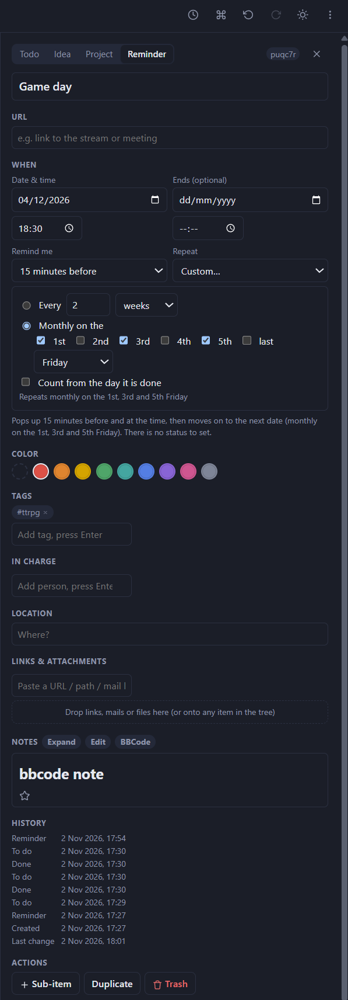

### The help window with all keyboard shortcuts (hotkey: ?)

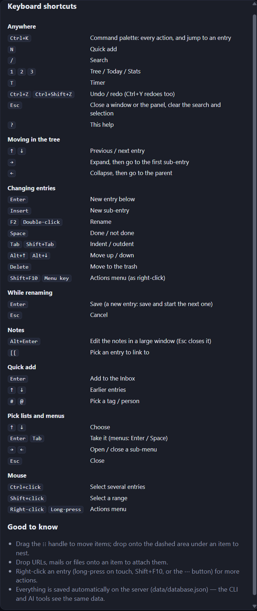

### The Today view with reminders, sci-fi theme

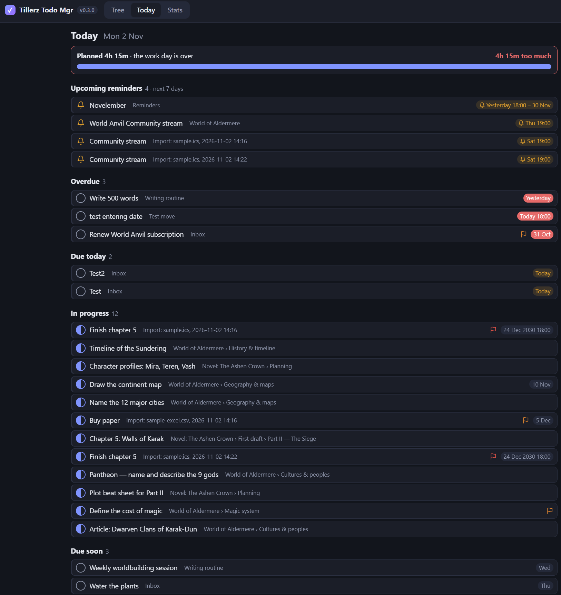

### Next 7 days: the week ahead, day by day

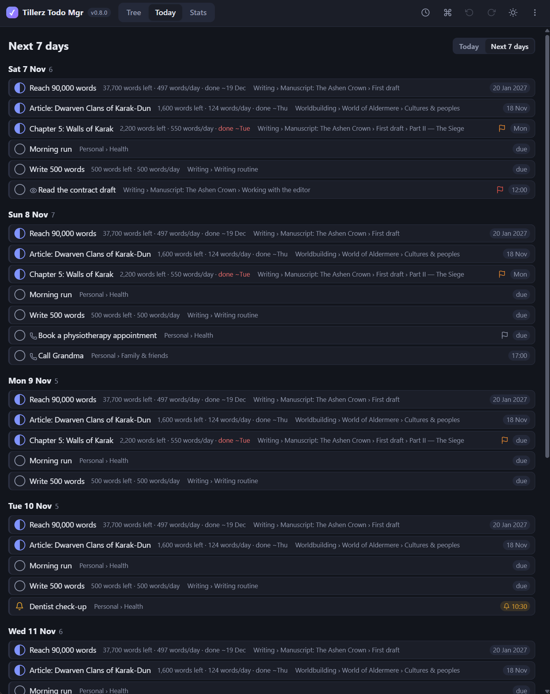

### The writing/work timer

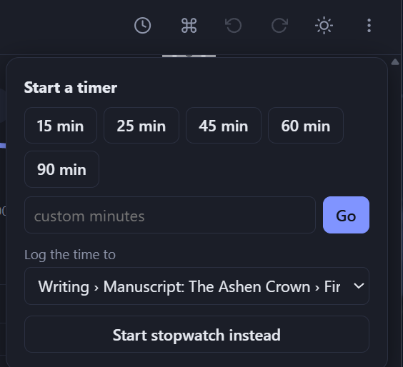

### The writing/work timer: finished

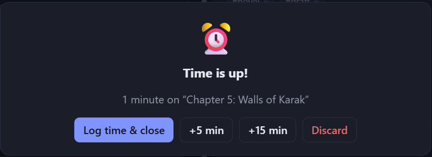

### The writing/work timer: logging words

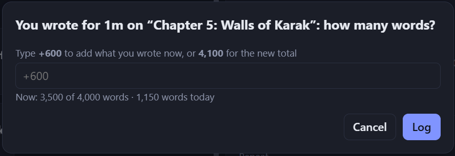

### Notes in BBCode (hotkey: Alt-Enter to open the notes of the current entry)

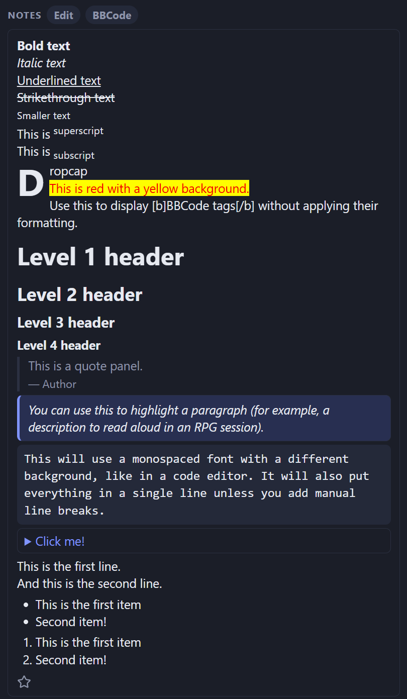

### The command palette (hotkey: Ctrl-K)

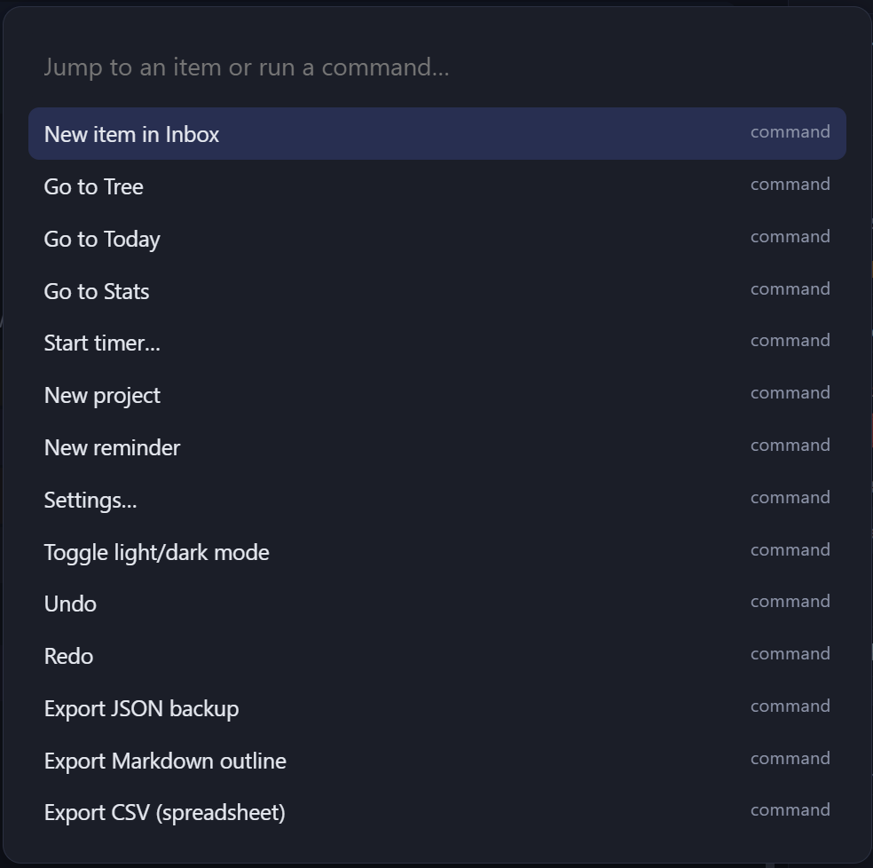

### The settings page

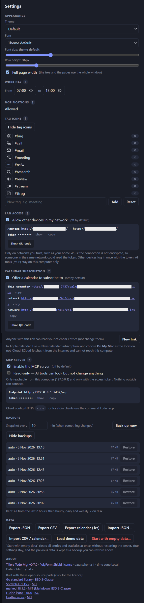

### The menu (top right icon)

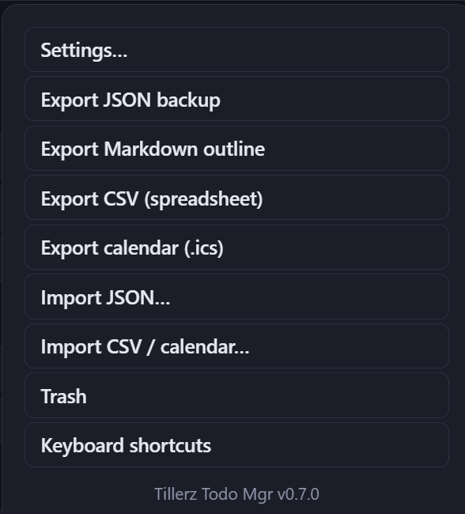

### The activity heatmap

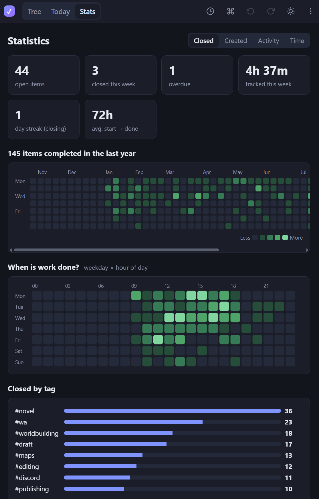

### The printable list

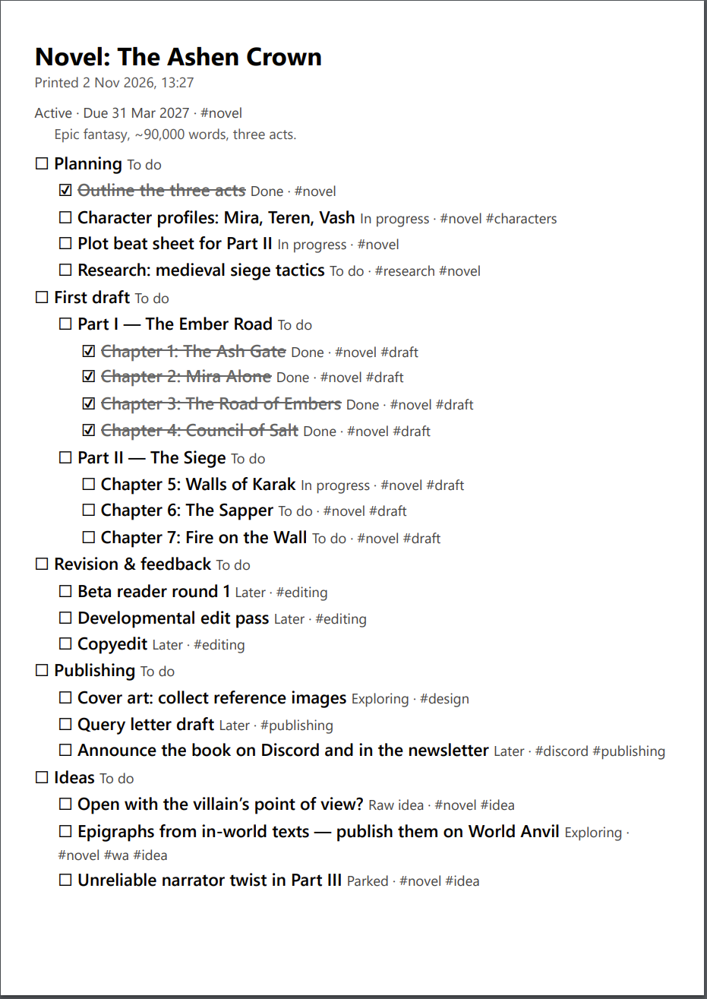

### Context Menu (right-click)

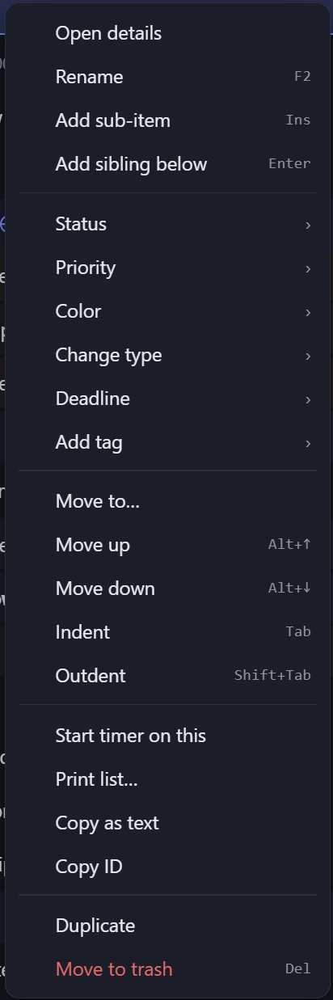

### The tree with the detail panel, light mode, pastel theme

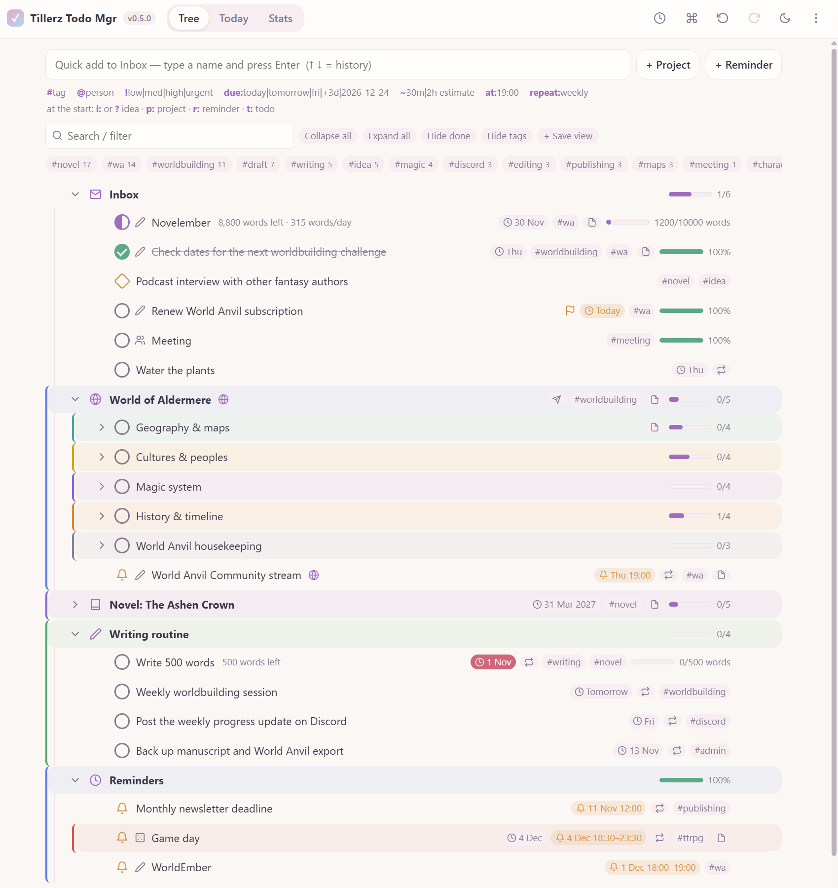

### The narrow layout

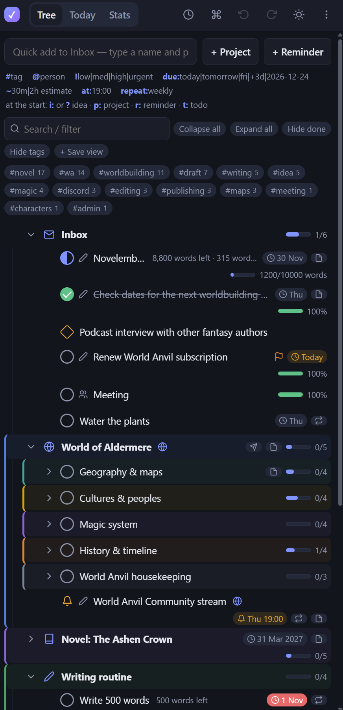

### Tree view, light mode, Fantasy (parchment)

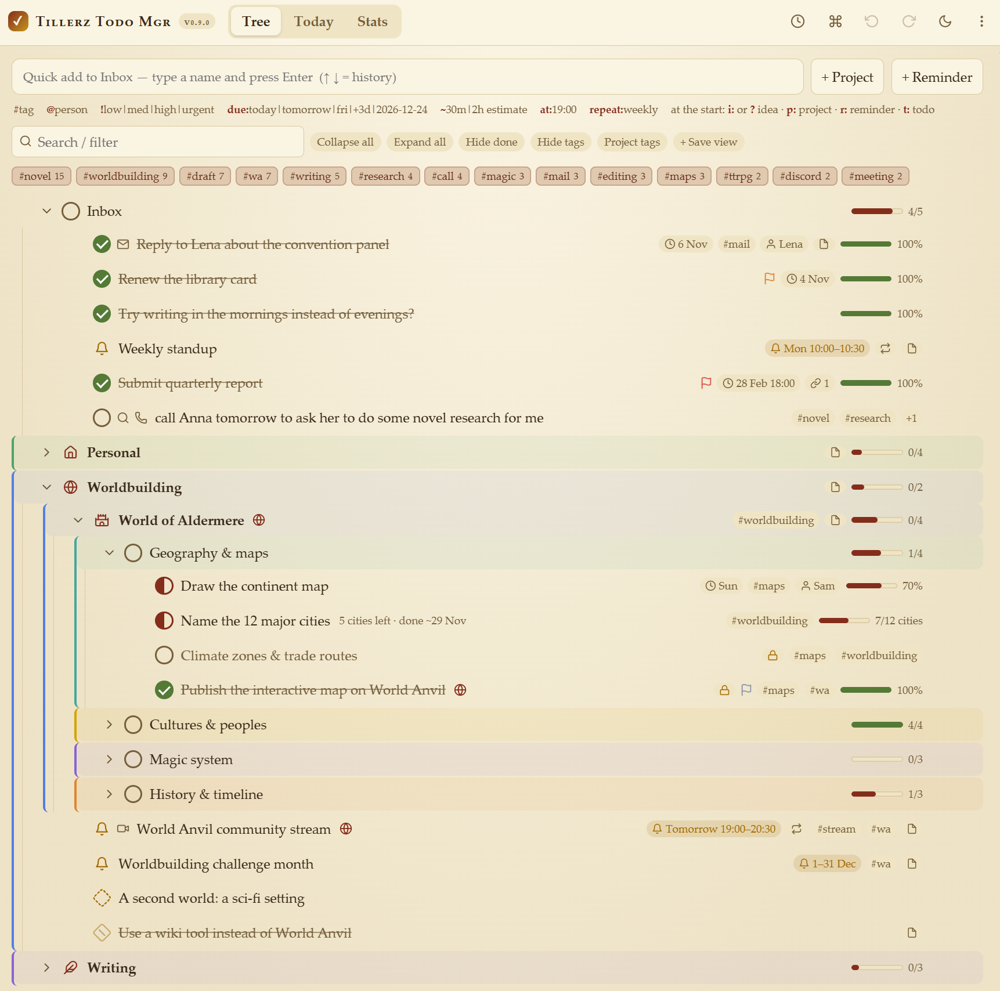

---

## MCP server for AI assistants

**Off by default.** Switch it on in the app: ⋯ → Settings → MCP server. It only accepts connections from this computer (also when LAN access is on), checks the `Host` and `Origin` headers (which defeats attacks from web pages) and needs the access token shown in Settings. A **read-only** switch lets AI tools look but not change anything. There is no hard delete: AI tools can only move entries to the trash, and a Discord webhook URL is hidden from them (they see `(set)`); they cannot post to Discord.

* HTTP: `http://127.0.0.1:7437/mcp` with the header `Authorization: Bearer <token>`
* stdio clients: command `todo mcp` (bridges to the running app; refuses to start while MCP is off)

Tools: `list_entries`, `get_entry`, `get_tree`, `today`, `stats`, `create_entry` (also accepts the quick-add text), `update_entry`, `set_status`, `move_entry`, `trash_entry`, `restore_entry`, `log_time`.

## HTTP API

The UI, the CLI and MCP all use the same HTTP API on `127.0.0.1:7437`. Every call needs the token (`Authorization: Bearer <token>`, or `X-Todo-Token`; the page itself uses a cookie, named after the data folder, so two copies of the program at the same address never mix up their logins). The token is in `data/config.json` and in Settings. `POST`, `PUT` and `PATCH` bodies must be `application/json`. Requests whose `Host` or `Origin` is not local are refused. With LAN access on, IP addresses and this computer's own name are accepted too, and other devices get the cookie from `POST /api/login {token}`.

| Method and path | Purpose |
|---|---|
| `GET /api/info` | name, version, schema, data folder, port |
| `GET /api/state` | everything the UI needs: entries, timer, settings, activity |
| `POST /api/sync` | the UI's batched changes (with conflict detection) |
| `GET /api/events` | live updates (Server-Sent Events: `hello`, `change`, `reload`) |
| `GET /api/nodes` | list and search entries (`q`, `tag`, `person`, `parent`, `project`, `status`, `kind`, `open`, `overdue`, `trashed`, `limit`) |
| `POST /api/nodes` | create an entry (`name`, `parent`, `index`, and any field) |
| `GET /api/nodes/{id}` | one entry with its path and computed values |
| `PATCH /api/nodes/{id}` | change fields |
| `DELETE /api/nodes/{id}` | move to the trash (never a hard delete) |
| `POST /api/nodes/{id}/status` | `{status}` |
| `POST /api/nodes/{id}/move` | `{parent, index}` |
| `POST /api/nodes/{id}/restore` | take out of the trash |
| `POST /api/nodes/{id}/time` | `{minutes}` or `{seconds}` – log time |
| `POST /api/quick` | `{text, parent}` – quick-add syntax |
| `GET /api/tree`, `/api/today`, `/api/stats` | the tree (`root`, `depth`), the Today lists, statistics (`days`) |
| `POST /api/alerts/ack` | `{id, action: "ok" \| "snooze"}` – dismiss or snooze a reminder pop-up |
| `POST /api/discord` | `{id, title, url}` – post to the Discord channel of the entry's project |
| `GET`/`PUT /api/settings` | MCP and LAN switches, backup interval |
| `POST /api/login` | `{token}` or `{pair}` – sets the cookie for another device (LAN access); no token needed, 5 tries a minute |
| `POST /api/lan/pair` | a new one-time login code (5 minutes, once) with a link and its QR code (SVG) per LAN address |
| `GET`/`POST /api/backups`, `POST /api/backups/restore` | list, create, restore |
| `GET /api/export`, `POST /api/import` | whole data as JSON / replace everything |
| `POST /api/import/entries` | `{format: "csv"\|"ics", name, data}` – add the entries of a CSV or calendar file below a new project; `preview: true` only lists them (`items`, nothing is saved), `only: [positions]` adds just those (past events included), `folder: false` puts them into the Inbox |
| `GET /cal/<key>.ics` | calendar subscription; no token, the calendar key is the access check (Settings) |
| `GET /api/export.csv`, `GET /api/export.ics` | spreadsheet / calendar export (`closed=1` or `closed=0` to include or leave out finished entries; default: CSV with, calendar without) |
| `POST /api/files` | `{name, data}` (base64, up to 10 MB) – keep a copy of a file; answers `{file}`, the key for a link's `file` field |
| `GET /api/files/{key}`, `/api/files/{key}/view` | download the file (`name` sets the file name) / what the viewer shows: `kind` text, mail or binary |
| `GET /api/ai`, `POST /api/ai/unload` | AI status (switched on, helper and model found, running) / stop the helper |
| `POST /api/ai/subtasks`, `/api/ai/rewrite` | `{id}` – suggested sub-tasks `{items}` / rewritten notes `{text}` (`mode`: `tidy` or `expand`); nothing is saved. `POST /api/ai/test` asks one short question |
| `POST /api/ai/summarize` | `{file, name}` – a summary of a stored file (mail, text, .docx, .odt; up to 8,000 characters): `{summary, warning, points, todos, dates}`; nothing is saved |
| `POST /api/ai/quick` | `{text, tags}` – the AI turns normal words into a Quick add line `{quick}`; nothing is saved |
| `POST /api/ai/tags` | `{id, tags}` – the AI picks up to 5 of these tags for the entry `{tags}`; nothing is saved |
| `POST /api/estimate` | `{id, ai}` – a suggested estimate `{minutes, reason, used, source}` from finished todos with tracked time; `ai: true` lets the AI guess when there is no such history; `minutes: 0` when there is nothing to go by |
| `POST /api/reset` | replace everything with empty data (a backup is taken first) |
| `POST /mcp` | MCP (JSON-RPC 2.0), only when enabled in Settings, header token only |

Entry fields: `name`, `kind` (todo, idea, project, reminder), `status`, `color` (`#rrggbb`), `prio` (0–4), `tags`, `people`, `location`, `deadline`, `reminder` and `end` (`YYYY-MM-DD` or `YYYY-MM-DDTHH:MM`; `end` is the end of an event, not before its start), `deps`, `notes`, `notesFormat` (`markdown` or `bbcode`), `links` (`[{title, uri}]`), `url` (http/https), `webhook` (Discord, projects), `prog` (`{mode: percent|units, done, total, unit}`; `{add: N}` adds N to done), `recur` (`d`, `w`, `m`, `y`; every N: `2w`, `3d`, `6m`; monthly on weekdays: `m:1fr,3fr,-1fr` with `-1` = last, every N months on weekdays: `2m:1fr`; a `+` at the end counts from the day it is done: `3d+`), `est` (minutes), `lead` (minutes of early warning for reminders), `discord` (true: also post a reminder to its project's channel).

## Licence

Tillerz Todo Mgr is under the [PolyForm Shield License 1.0.0](LICENSE). You may use it, change it and share it, also at work, free of charge. You may not sell it or offer a product that competes with it.

## Third-party licences

The program uses these open-source parts. They are bundled into the program, and their licence texts are in [app/web/licenses/](app/web/licenses/). The app shows the same list under Settings → About.

| Part | Used for | Licence |
|---|---|---|
| [Go standard library](https://go.dev/) | the program itself | BSD 3-Clause, [go.txt](app/web/licenses/go.txt) |
| [SortableJS](https://github.com/SortableJS/Sortable) 1.15.2 | drag and drop in the tree | MIT, [sortablejs.txt](app/web/licenses/sortablejs.txt) |
| [marked](https://marked.js.org/) 18.1.2 | Markdown in notes | MIT (and BSD 3-Clause for Markdown), [marked.txt](app/web/licenses/marked.txt) |
| [Lucide](https://lucide.dev/) 1.66.0 | tag icons | ISC, [lucide.txt](app/web/licenses/lucide.txt) |
| [Feather](https://feathericons.com/) | app icons | MIT, [feather.txt](app/web/licenses/feather.txt) |
